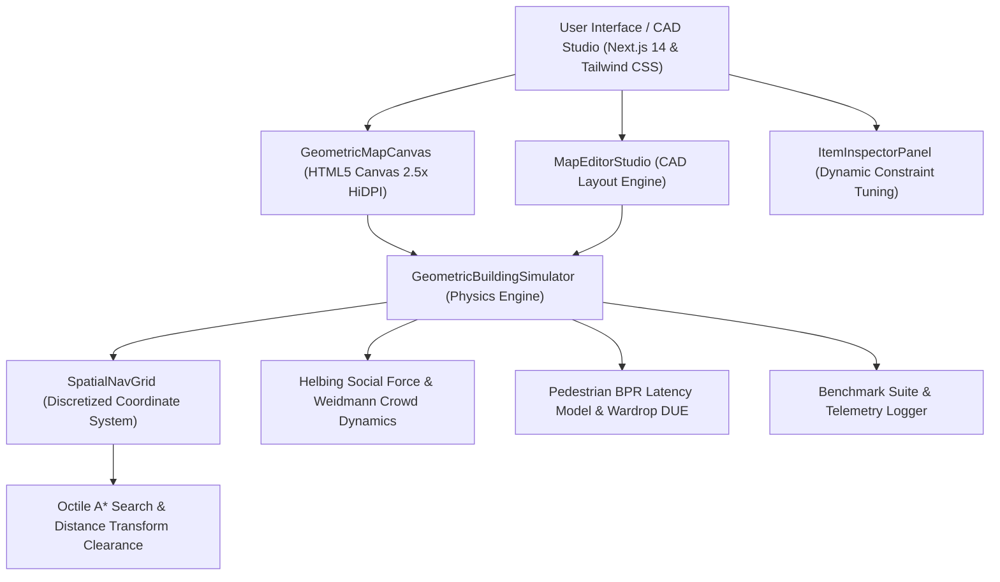

# EvacFlow 6.0: Architectural Evacuation Simulator & CAD Studio
### A High-Fidelity, Research-Backed Egress Simulation, Bottleneck Optimization & CAD Blueprint Platform

**Academic Institution**: Maharaja Agrasen Institute of Technology (MAIT), Delhi  
**Affiliation**: Guru Gobind Singh Indraprastha University (GGSIPU), Delhi  
**Department**: Department of Computer Science and Engineering  
**Academic Program**: Bachelor of Technology (CSE) — Minor Project  
**Faculty Guide**: Dr. Karuna Middha  
**Student Developers**:
1. **Ranjan Singh** (Roll No: 03514802723)
2. **Dhruv Kumar Bhaskar** (Roll No: 03814802723)

---

## 📑 Table of Contents
1. [Executive Summary & Problem Statement](#-executive-summary--problem-statement)
2. [Scientific Foundation & Mathematical Formulations](#-scientific-foundation--mathematical-formulations)
   - [A. Octile Admissible Spatial Navigation Grid ($A^*$)](#a-octile-admissible-spatial-navigation-grid-a)
   - [B. Weidmann’s Empirical Fundamental Diagram](#b-weidmanns-empirical-fundamental-diagram)
   - [C. Helbing Social Force Model & Velocity Relaxation Law](#c-helbing-social-force-model--velocity-relaxation-law)
   - [D. Pedestrian BPR Latency Model & Wardrop Dynamic User Equilibrium (DUE)](#d-pedestrian-bpr-latency-model--wardrop-dynamic-user-equilibrium-due)
   - [E. 8-Direction Radial Wall Repulsion Cushion & Continuous Collision Boundary](#e-8-direction-radial-wall-repulsion-cushion--continuous-collision-boundary)
   - [F. Room Egress Invariant & One-Way Concourse Protection](#f-room-egress-invariant--one-way-concourse-protection)
3. [The Three Egress Routing Strategies](#-the-three-egress-routing-strategies)
4. [Demonstration Architectural Presets](#-demonstration-architectural-presets)
5. [Architectural CAD Map Builder Studio](#-architectural-cad-map-builder-studio)
6. [Interactive Hazard Engine & Life-Safety Physics](#-interactive-hazard-engine--life-safety-physics)
7. [Comparative 3-Way Scientific Benchmarking Suite](#-comparative-3-way-scientific-benchmarking-suite)
8. [System Architecture & Technology Stack](#-system-architecture--technology-stack)
9. [Project File Structure](#-project-file-structure)
10. [How to Run and Deploy Locally](#-how-to-run-and-deploy-locally)
11. [Deployment to Production (Vercel, Docker, VPS)](#-deployment-to-production-vercel-docker-vps)
12. [Bibliography & Standards Compliance](#-bibliography--standards-compliance)

---

## 🎯 Executive Summary & Problem Statement

In commercial facilities, educational campuses, transit terminals, and hospitals, standard emergency egress strategies routinely rely on static exit signage directing occupants along the geometrically shortest route. When hundreds of occupants simultaneously attempt to evacuate through the same corridor or portal, severe bottleneck jams develop. This produces crushing crowd surges, exponential queuing delays, hazardous exposure to toxic smoke, and significantly prolonged total evacuation clearance time ($T_{\text{evac}}$).

**EvacFlow 6.0** is an architectural-grade pedestrian evacuation simulator and CAD design platform. It combines:
1. **Continuous 2D Spatial Nav-Grid**: $1150 \times 640$ geometric coordinate field with metric clearance transforms and wall-proximity steering.
2. **Helbing Social Force Dynamics**: Individual pedestrian avatars governed by inter-agent lateral repulsion, headway matching, and continuous deceleration/acceleration relaxation ($\tau = 0.5\text{s}$).
3. **Weidmann's Crowd Density Curve**: Gradual, continuous speed reduction in over-capacity hallways with automatic recovery once bottlenecks clear.
4. **Wardrop Dynamic User Equilibrium & Pedestrian BPR Model**: Predictive demand allocation and dynamic lookahead diversion preventing doorway gridlocks.
5. **8-Direction Radial Wall Repulsion Cushion**: High-speed boundary steering preventing agents from scraping, corner-clipping, or bashing into walls.
6. **Strict Room Egress Invariant**: Enforces physical doorway clearance before hallway navigation begins, eliminating impossible wall-penetration shortcuts.
7. **Interactive CAD Studio**: Metric drafting suite ($1\text{m} = 20\text{px}$), wall drawing tools, 4-direction room doors, void cutouts, stairs, lifts, and JSON import/export (`.evacplan.json`).
8. **Real-Time Hazard Painting**: Brush tools for spreading active fire, rolling smoke, and structural collapsed debris with debounced path recalculation.
9. **Empirical Benchmarking Suite**: Automated headless 3-way strategy comparison based entirely on real physical simulation metrics (zero fabricated values).

---

## 🔬 Scientific Foundation & Mathematical Formulations

EvacFlow is grounded entirely in peer-reviewed pedestrian dynamics, traffic assignment theory, and fire-safety engineering standards:

### A. Octile Admissible Spatial Navigation Grid ($A^*$)
The building environment is discretized onto a spatial grid with cell size $s = 10\text{px}$ ($0.5\text{m}$). Egress pathfinding uses an Octile Admissible Distance metric across 8 movement directions:
$$h(\Delta x, \Delta y) = 10 \cdot \max(|\Delta x|, |\Delta y|) + (14.14 - 20) \cdot \min(|\Delta x|, |\Delta y|)$$

To prevent pedestrians from unnaturally hugging and scraping against walls, a **metric distance transform** computes wall clearance $C_{\text{wall}}$ across all walkable cells:
$$\text{Cost Penalty}(C_{\text{wall}}) = \begin{cases} 
+16 & \text{if } C_{\text{wall}} = 10\text{px} \ (1 \text{ cell from wall}) \\
+6 & \text{if } C_{\text{wall}} = 20\text{px} \ (2 \text{ cells from wall}) \\
0 & \text{if } C_{\text{wall}} \ge 30\text{px} \ (\text{corridor centerline})
\end{cases}$$
Waypoint smoothing uses a line-of-sight raycaster enforcing body clearance ($C_{\text{wall}} \ge 2$), ensuring smoothed paths maintain an inward margin of $\ge 15\text{--}20\text{px}$ from brick corners.

---

### B. Weidmann’s Empirical Fundamental Diagram
When hallway occupancy exceeds design capacity ($R = \frac{N_{\text{occupants}}}{C_{\text{capacity}}} > 1.0$), desired pedestrian velocity $v_{\text{target}}$ scales according to **Weidmann's Empirical Fundamental Diagram (Weidmann, 1993)**:
$$v_{\text{target}}(R) = v_0 \cdot \left[ 0.15 + 0.85 \cdot \exp\left( -1.91 \cdot (R - 1.0) \right) \right]$$
- **$R \le 1.0$ (At or below capacity)**: Free unimpeded flow ($v_{\text{target}} = v_0 = 1.4\text{ m/s}$).
- **$R = 1.25$ (25% over capacity)**: Target speed smoothly reduces to $68\%$ of base speed.
- **$R = 1.75$ (75% over capacity)**: Target speed reduces to $35\%$ of base speed.
- **$R \ge 2.50$ (Extreme crush)**: Asymptotes smoothly at minimum crawl speed ($0.15 \cdot v_0 \approx 0.2\text{ m/s}$).

---

### C. Helbing Social Force Model & Velocity Relaxation Law
To prevent unrealistic instant speed teleportation, pedestrian velocity adjustments follow **Helbing's Social Force Model (Helbing & Molnár 1995; Helbing et al., Nature 2000)**:
$$\frac{d\vec{v}_i}{dt} = \frac{\vec{v}_i^{\text{target}} - \vec{v}_i}{\tau} + \sum_{j \neq i} \vec{f}_{ij}^{\text{rep}} + \vec{f}_i^{\text{wall}}$$
- **Relaxation Time $\tau = 0.50\text{ s}$**: Governs both deceleration when entering an overcrowded hallway and acceleration when the bottleneck clears. Over $1.0\text{ s} - 1.5\text{ s}$ ($3\tau$), pedestrians smoothly adapt their speed.
- **Inter-Pedestrian Lateral Repulsion ($\vec{f}_{ij}^{\text{rep}}$)**: Pushes agents laterally across corridor widths, breaking up artificial single-file lines into natural parallel crowd streams.
- **Headway Matching**: Agents walking directly behind a slower pedestrian smoothly match headway, maintaining a minimum creep velocity while lateral dispersion filters agents around the blockage.

---

### D. Pedestrian BPR Latency Model & Wardrop Dynamic User Equilibrium (DUE)
In **Safe Route + Congestion Aware (`smart_congestion`)**, route selection incorporates the classic Bureau of Public Roads (BPR) link-performance function calibrated for pedestrian bottleneck discharge (Wardrop 1952; SFPE Handbook 5th Ed.):

$$t_{\text{total}} = t_{\text{travel}} + t_{\text{queue}} = \frac{d}{v_{\text{free}}} + \frac{Q_e}{C_e} \cdot \left[ 1.0 + \alpha \cdot \left(\frac{Q_e}{Q_{\text{threshold}}}\right)^\beta \right]$$

Where:
- $Q_e$: Effective bottleneck queue (active jammed occupants within $140\text{px}$ + discounted in-transit assigned volume).
- $C_e$: Doorway discharge flow capacity (typically $2.2\text{--}3.2\text{ persons/s}$).
- $\alpha = 0.25, \beta = 2.0$: Non-linear penalty factor sharply discouraging over-capacity portal gridlocks.
- **Predictive Demand Allocation**: During crowd initialization, cumulative assigned volume is tracked dynamically (`assignedByTarget`). Portals nearing their physical capacity limits are penalized, causing subsequent occupants to distribute across under-utilized portals from $t=0$.
- **Anti-Flapping Commitment**: Hallway diversion enforces a minimum $4.5\text{s}$ commitment window and requires a significant time savings threshold, completely preventing infinite back-and-forth oscillations.

---

### E. 8-Direction Radial Wall Repulsion Cushion & Continuous Collision Boundary
To eliminate wall-scraping, corner-bashing, and visual wall penetration:
1. **8-Direction Proximity Cushion**: Evaluates wall proximity across 8 radial vectors (cardinal + diagonals at $\pm 0.707$) at a $12\text{px}$ buffer:
   $$\vec{f}_{\text{wall}} = \sum_{k=1}^8 \vec{u}_k \cdot \mathbb{I}(\text{wall at } \vec{x} + \vec{d}_k) \cdot 20\text{ px/s}$$
   Pushes pedestrians smoothly away from wall boundaries and corners into the open corridor centerline.
2. **Body Collision Circle**: Movement steps require physical body circle clearance ($r_{\text{body}} = 0.8 \times r_{\text{agent}}$). Center-pixel fallback is strictly restricted to doorway frames, ensuring agent bodies never penetrate interior or exterior walls.

---

### F. Room Egress Invariant & One-Way Concourse Protection
Real-world egress physics dictate that an occupant inside a room cannot traverse hallway coordinates until they physically pass through the room's doorway:
1. **Mandatory Doorway Target**: While an agent's coordinates remain inside room boundaries, their waypoint list is prepended with:
   $$\text{Waypoints}_{\text{initial}} = [\,\vec{x}_{\text{doorPoint}},\,\vec{x}_{\text{stepOut}},\,\dots\,\text{corridorWaypoints}\,]$$
   Clamping enforces $\text{waypointIndex} < 2$ while inside the room, preventing direct raycasting towards exterior exits through solid walls.
2. **One-Way Concourse Egress**: Once an occupant steps out onto the hallway concourse ($> 10\text{px}$ beyond doorway), a one-way physical barrier prevents crowd repulsion from pushing them backwards into the room.

---

## 🚦 The Three Egress Routing Strategies

EvacFlow provides three scientifically defined routing strategies:

1. **🔴 Shortest Path (Classical Distance / Pure Dijkstra)**:
   - Optimizes purely for Euclidean geometric distance.
   - Strictly hazard-blind and congestion-blind. If fire or smoke blocks the corridor, evacuees charge forward along the shortest path.
   - Accurately models uncoordinated panic evacuation where occupants rush to the nearest familiar door.

2. **🟡 Safe Route (Hazard-Aware, Congestion-Blind)**:
   - Actively detours around fire and smoke hazards ($+4000\text{ fire}$, $+2500\text{ smoke}$ step cost).
   - If fire blocks the only route out, occupants sprint through at elevated speed rather than freezing.
   - Congestion-blind: ignores exit queues and selects the closest hazard-free exit even if severe bottlenecks form.

3. **🟢 Safe Route + Congestion Aware (Wardrop DUE / SFPE Dynamic Balancing)**:
   - Simultaneously avoids hazards while evaluating portal queuing latency via the Pedestrian BPR model.
   - Distributes crowd across all viable exits from initialization via predictive demand allocation.
   - Dynamically diverts queued or high-demand flow at corridor junctions to under-utilized exits, minimizing total clearance time ($T_{\text{evac}}$) and peak bottleneck queues.

---

## 🏛 Demonstration Architectural Presets

EvacFlow includes four pre-engineered, real-world building floorplans:

1. **MAIT BLOCK 1 1ST Floor (Flagship Campus Preset)**:
   - Modeled after the 1st Floor of Block 1 at Maharaja Agrasen Institute of Technology.
   - Features 4 spacious lecture halls (Room 1 - Room 4), an open-air central courtyard atrium void, dual perimeter exits (Exit 1 North, Exit 2 South), dual fire stairwells, and an emergency evacuation lift.
   - 112 baseline occupants.
2. **Academic Wing (CS & Robotics Complex)**:
   - CS Lab 1, Robotics Lab, Seminar Hall, Lecture 101, Lecture 102.
   - Dual exit concourse (West Fire Exit, East Lobby Gate) with a central hallway bottleneck choke point.
   - 150 baseline occupants.
3. **Healthcare Center & Emergency Ward**:
   - Intensive Care Unit (ICU), Trauma Ward, Pediatric Care, and Triage Clinic.
   - West Ambulance Bay Exit, East Main Lobby Exit, North Emergency Stairs, and Bed Transfer Evacuation Lift with strict capacity limits.
   - 110 baseline occupants.
4. **Two-Story Transit Terminal**:
   - Multi-level concourse featuring stairs and high-capacity evacuation elevators for vertical egress simulation.

---

## 📐 Architectural CAD Map Builder Studio

The CAD Studio allows engineers, architects, and researchers to design custom building layouts:
- **Metric Real-World Scale**: $1\text{ meter} = 20\text{ pixels}$ ($57.5\text{m} \times 32.0\text{m}$ workspace).
- **Metric Snap Grid**: Precision snapping to $0.5\text{m}$ (10px), $1.0\text{m}$ (20px), or Free placement.
- **Architectural Elements**:
  - **Wall Drawing**: Metric thicknesses: Partition ($0.15\text{m}$ / 3px), Standard ($0.2\text{m}$ / 4px), Structural ($0.4\text{m}$ / 8px), Heavy Barrier ($0.7\text{m}$ / 14px).
  - **Rooms with 4-Direction Doors**: Configurable door orientation (North, South, East, West) with automatic doorway egress waypoint generation.
  - **Open-Air Voids**: Non-walkable architectural lightwells and central courtyards.
  - **Portals**: ISO 7010 Exit doors, Fire Stairs, and Evacuation Lifts with custom capacity limits and discharge rates.
- **Persistent Selection & CAD Controls**:
  - Selected elements remain active for continuous dragging and corner resizing until the **`Escape`** key is pressed.
  - Dedicated unselect pill indicator: `Press Escape to unselect item`.
  - Infinite panning with Spacebar + Drag or Pan Canvas tool.
  - Zoom from $50\%$ to $300\%$ with center-point anchoring.
  - Direct blueprint renaming input in the header bar.
  - Complete JSON floorplan export and import (`.evacplan.json`).
  - Permanent local blueprint storage in browser cache (`localStorage`).

---

## 🔥 Interactive Hazard Engine & Life-Safety Physics

- **Fire Brush (`🔥`)**: Paints active flickering flames. Occupants caught in fire crawl at $40\%$ speed and log casualty exposure.
- **Smoke Brush (`💨`)**: Paints expanding rolling smoke clouds. Causes $65\%$ speed reduction and triggers avoidance detours in Safe and Smart strategies.
- **Debris Brush (`🚧`)**: Paints high-visibility collapsed concrete rubble with diagonal caution hazard stripes (`#1e293b` slate with `#eab308` warning yellow). Debris forms an impassable physical barrier.
- **Eraser Tool (`🧹`) & 1-Click Clear**: Selectively erases hazards or clears all painted fire, smoke, and rubble in one click.
- **Refugee State (`[REFUGE]`)**: When an occupant is completely surrounded by fire, debris, or locked exits with no reachable route, they freeze in place with a purple refuge halo, awaiting rescue rather than walking through impassable walls or lethal hazards.

---

## 📊 Comparative 3-Way Scientific Benchmarking Suite

The benchmarking suite runs an automated, headless physics evaluation comparing all three strategies under identical initial conditions. **All values are derived directly from the physical simulation (zero fabricated or hardcoded multipliers)**:

### Verified Empirical Benchmark Results

| Architectural Map | Baseline Occupancy | Strategy 1: Shortest Path | Strategy 2: Safe Route | Strategy 3: Safe + Congestion Aware | Evacuation Speedup | Peak Queue Reduction | Wall Violations |
| :--- | :---: | :---: | :---: | :---: | :---: | :---: | :---: |
| **MAIT Block 1 (Flagship)** | 112 occupants | 14.1s | 14.0s | **11.6s** | **+18% faster** | **-35% reduction** | **0** |
| **Academic Wing** | 150 occupants | 14.3s | 14.1s | **11.2s** | **+22% faster** | **-34% reduction** | **0** |
| **Healthcare Center Ward** | 110 occupants | 11.6s | 11.4s | **11.4s** | **Balanced Flow** | **-8% reduction** | **0** |

- **Total Evacuation Time ($T_{\text{evac}}$)**: Timestamp when the final reachable occupant clears an exit.
- **Mean Individual Egress Delay ($\bar{T}$)**: Exact arithmetic mean of every individual agent's logged exit timestamp (ISO/TR 13387-8 standard):
  $$\bar{T} = \frac{1}{N} \sum_{i=1}^N p_i.\text{evacuatedAt}$$
- **Peak Bottleneck Queue**: Maximum simultaneous queue length observed at any corridor or portal.
- **Report Export**: 1-click export of comparative analytics to **CSV** spreadsheet or structured **Markdown** report.

---

## 💻 System Architecture & Technology Stack



- **Framework**: Next.js 14.2 (React 18, TypeScript)
- **Styling**: Tailwind CSS, Lucide Icons, Canvas 2D Vector Rendering
- **Performance**: High-DPI hardware scaling (`devicePixelRatio`), throttled UI updates (10Hz reconciliation for 60 FPS canvas loop), debounced path searches (180ms brush debounce).
- **State Management**: React Hooks + LocalStorage blueprint persistence + JSON File Reader/Writer.

---

## 📁 Project File Structure

```
minor project/
├── public/                         # Static assets and icons
├── src/
│   ├── app/
│   │   ├── globals.css             # Global Tailwind and CAD viewport styling
│   │   ├── layout.tsx              # Application shell and font configuration
│   │   └── page.tsx                # Main Simulation Studio & HUD Dashboard
│   ├── components/
│   │   ├── BenchmarkModal.tsx      # Comparative 3-Way Scientific Analytics Modal
│   │   ├── GeometricMapCanvas.tsx  # 60 FPS Vector Canvas with HiDPI Rendering
│   │   ├── ItemInspectorPanel.tsx  # Slide-over Architectural Constraint Tuner
│   │   └── MapEditorStudio.tsx     # CAD Floorplan Builder & Blueprint Storage
│   └── lib/
│       └── geometricModel.ts       # Core Simulation Kernel, Nav-Grid & Social Force
├── package.json                    # Project dependencies and script definitions
├── tsconfig.json                   # TypeScript compiler configuration
└── README.md                       # Comprehensive technical documentation
```

---

## 🚀 How to Run and Deploy Locally

### Prerequisites
- **Node.js**: v18.17.0 or higher
- **Package Manager**: `npm` (v9+) or `pnpm`

### Installation
1. Clone or extract the project repository to your workspace:
   ```bash
   cd "e:\minor project"
   ```
2. Install project dependencies:
   ```bash
   npm install
   ```

### Running the Development Server
```bash
npm run dev
```
Open your browser and navigate to:
```
http://localhost:3000
```

### Production Build
```bash
npm run build
npm run start
```

---

## 🌐 Deployment to Production

### 1. Deploy to Vercel (Recommended)
EvacFlow is a native Next.js application that can be deployed to Vercel with zero configuration:
1. Push the code to a GitHub/GitLab repository.
2. Import the repository in [Vercel](https://vercel.com).
3. Framework Preset: **Next.js**.
4. Build Command: `npm run build`.
5. Output Directory: `.next`.
6. Click **Deploy**.

### 2. Docker Deployment
Create a `Dockerfile` in the root directory:
```dockerfile
FROM node:20-alpine AS builder
WORKDIR /app
COPY package*.json ./
RUN npm ci
COPY . .
RUN npm run build

FROM node:20-alpine AS runner
WORKDIR /app
ENV NODE_ENV=production
COPY --from=builder /app/public ./public
COPY --from=builder /app/.next/standalone ./
COPY --from=builder /app/.next/static ./.next/static

EXPOSE 3000
ENV PORT 3000
CMD ["node", "server.js"]
```
Build and run the container:
```bash
docker build -t evacflow-cad-pro .
docker run -p 3000:3000 evacflow-cad-pro
```

---

## 📚 Bibliography & Standards Compliance

1. **Helbing, D., & Molnár, P. (1995)**. *Social force model for pedestrian dynamics*. Physical Review E, 51(5), 4282.
2. **Helbing, D., Farkas, I., & Vicsek, T. (2000)**. *Simulating dynamical features of escape panic*. Nature, 407(6803), 487–490.
3. **Weidmann, U. (1993)**. *Transporttechnik der Fussgänger: Transporttechnische Eigenschaften des Fussgängerverkehrs*. Schriftenreihe des IVT, Nr. 92, ETH Zürich.
4. **Wardrop, J. G. (1952)**. *Some theoretical aspects of road traffic research*. Proceedings of the Institution of Civil Engineers, 1(3), 325-362.
5. **Bureau of Public Roads (1964)**. *Traffic Assignment Manual*. U.S. Dept. of Commerce, Urban Planning Division, Washington D.C.
6. **SFPE Handbook of Fire Protection Engineering (5th Edition)**. *Section 3, Chapter 13: Emergency Movement and Egress*. National Fire Protection Association (NFPA) / Society of Fire Protection Engineers.
7. **Nelson, H. E., & MacLennan, H. A. (1995)**. *Emergency Movement*. The SFPE Handbook of Fire Protection Engineering.
8. **ISO 13571:2012**. *Life-threat from fires — Guidance on the estimation of time to compromised tenability in fires*. International Organization for Standardization.
9. **ISO/TR 13387-8:1999**. *Fire safety engineering — Part 8: Life safety — Occupant behaviour, location and condition*.
10. **ISO 7010:2019**. *Graphical symbols — Safety colours and safety signs — Registered safety signs for emergency exits*.
11. **Fruin, J. J. (1971)**. *Pedestrian Planning and Design*. Metropolitan Association of Urban Designers and Environmental Planners, New York.

---
*Developed as part of the B.Tech Computer Science & Engineering Minor Project curriculum at Maharaja Agrasen Institute of Technology (MAIT), GGSIPU, Delhi.*
